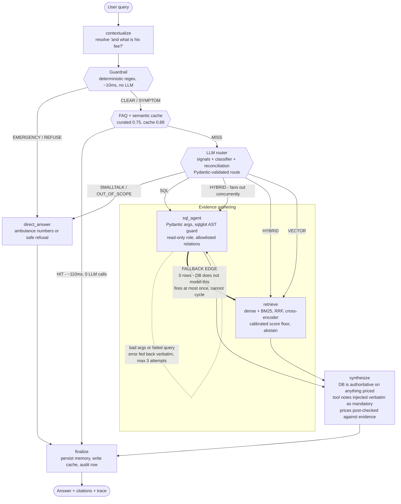

# Nawaloka Agent - Architecture Notes

A hybrid RAG + SQL agent for a hospital assistant. Patient questions are routed between a **relational database** (doctors, fees, channeling schedules, lab tests, health packages) and a **vector store** built from `nawaloka.com`. Some questions need one source, some need both, and getting that routing decision right is the core of the system.

This document covers architecture, routing logic, engineering challenges and future work. For setup and run instructions, see [README.md](README.md).

## Contents

- [Key Features](#key-features)
- [System Architecture](#system-architecture)
- [Routing & Fallback Logic](#routing--fallback-logic)
- [Engineering Challenges & Solutions](#engineering-challenges--solutions)
- [Tech Stack](#tech-stack)
- [Project Layout](#project-layout)
- [Responsible AI](#responsible-ai)
- [Known Limitations](#known-limitations)
- [Production Roadmap & Future Improvements](#production-roadmap--future-improvements)
- [License](#license)

## Key Features

### Validated SQL execution

Every statement the model produces is parsed into an AST with `sqlglot` and inspected before execution - never regex-matched, because string filters on `DROP` are defeated by comments, casing, or a write wrapped in a CTE.

| Layer | Guarantee |
|---|---|
| Pydantic tool args | A malformed tool call fails validation before any SQL is built |
| AST validation | One statement only; root must be `SELECT`; no write/DDL node at any depth |
| Relation allowlist | 8 tables/views only - `routing_decisions` and `user_memory` are structurally unreachable |
| AST `LIMIT` clamping | Rewritten in the tree, never string-concatenated |
| Read-only DB role | `chatbot_ro` cannot write and cannot read conversation logs |

Defence in depth - the AST guard is the first of four layers, not the only one.

### Multi-route classification

Seven terminal routes: `SQL`, `VECTOR`, `HYBRID`, `SMALLTALK`, `OUT_OF_SCOPE`, plus `EMERGENCY` and `REFUSE` decided before any model runs. The classifier's output is validated against a Pydantic schema, so a hallucinated route name raises rather than silently falling through the graph's branch table.

### FAQ fast path and semantic cache

Two tiers, both one embedding and one vector lookup - roughly 110 ms and zero LLM calls, against ~6 s and three LLM calls for a full turn.

- Tier 1, curated FAQs at `0.75` similarity (hand-written, human-checked)
- Tier 2, semantic cache at `0.88` (higher bar - nobody reviewed those answers)

What must never be cached is the important part. `SQL` and `HYBRID` turns are never written to the cache: fees, schedules and package contents are mutable, and serving a stale price is the worst thing this cache could do. Entries are scoped by `corpus_version`, so re-ingesting the site invalidates everything without a delete pass.

### Clinical safety guardrails

Emergency interception is deterministic regex, no model call, roughly 10 ms. Someone typing "my father collapsed" must not wait on a rate-limited API, and must not depend on a model deciding to be careful. A regex list can also be asserted in CI; a prompt instruction cannot.

- `EMERGENCY` returns a fixed response with the national ambulance number and the Nawaloka ETU line. 12 pattern families: cardiac, stroke, airway, haemorrhage, overdose, self-harm, seizure, trauma.
- `REFUSE` covers diagnosis, dosage, test-result interpretation, medication changes and booking actions.
- Over-triggering is treated as a failure too. "Do you have a stroke rehabilitation programme" is a service question - a `SERVICE_QUERY` match without `ACUTE_FRAMING` suppresses the emergency verdict, so it is never answered with an ambulance number.
- Naming the specialty that treats a complaint is navigation and is allowed. Saying what is wrong with you is not.

### Fallback mechanisms

| Failure | Behaviour |
|---|---|
| SQL returns 0 rows | Turn detours through vector retrieval before synthesis; fires at most once, so it cannot cycle |
| Bad tool args / rejected SQL | Error text is fed back into the next prompt; up to 3 attempts, then it gives up honestly |
| LLM router unavailable | Falls back to deterministic signal routing |
| Provider rate-limited | Groq → Gemini → OpenRouter, paced by a token budget rather than a request count |
| Database down | Signal rules that depend on the DB-derived gazetteer stand down rather than mis-widening every query |

### Centralised configuration

Every threshold lives in `app/config.py` and is overridable by environment variable - nothing tunable is buried in code. The constants that matter were calibrated against measured distributions rather than guessed: the retrieval score floor, both cache thresholds, the router confidence bands, and `DECISIVE_MARGIN`.

## System Architecture



### Why LangGraph, and not a tool-calling loop

Correct routing is central to answer quality, so the router is a standalone function rather than an emergent side effect of a model's tool choice. In a tool-calling loop, routing is entangled with generation - hard to reason about, and hard to fix in isolation.

Two consequences follow from that choice:

- `HYBRID` fans out to both sources concurrently. The nodes write different state keys (`sql_calls` vs `documents`), so there is no reducer conflict and no locking.
- Self-correction is a graph edge, not a loop inside a function. A `ValidationError` and a rejected SQL statement take the same recovery path, the retries appear in the trace panel, and argument validation is covered - which an in-tool repair loop could not reach.

## Routing & Fallback Logic

### Three layers, in order

1. **Guardrail** - short-circuits `EMERGENCY` and `REFUSE` outright. The classifier never sees them.
2. **LLM classifier** - Pydantic-validated output. A hallucinated route name fails here, not in the graph.
3. **Reconciliation** - deterministic signals may widen the model's answer. They may never narrow it.

Layer 3 is the part worth understanding. Signals are evidence, not a decision: they come from a gazetteer built out of the live database plus generic intent words, and either can legitimately be absent for a perfectly good question. So a rule may only ever widen `SQL` or `VECTOR` to `HYBRID`. Adding a source is recoverable; removing one is not.

| Rule | Fires when | Widens to |
|---|---|---|
| No structured subject | Route is `SQL`, but the query names no database record and no database attribute | `HYBRID` / `VECTOR` |
| Both signal families | Transactional and descriptive parts both present, confidence below `0.80` | `HYBRID` |
| Low confidence | Confidence below `0.50` - the model was guessing | `HYBRID` |

Ordered, first match wins. The structural rule goes first because it is about what the question *is*, which outranks how confident the model happened to be - a confident `SQL` route with nothing to look up is still wrong. `SMALLTALK` and `OUT_OF_SCOPE` are exempt entirely: whether a question is in scope is not something keyword signals get a vote on.

### DECISIVE_MARGIN - mapping symptoms to a clinic without diagnosing

Mapping "cough for two weeks" to Respiratory Medicine is navigation, and it is one of the more useful things this assistant does. But absolute similarity does not separate a real complaint from noise: "Corporate" and "LASIK" both score above the retrieval floor and come back mapped to three unrelated clinics, which is how a dental question once got answered with general physicians.

The shape of the result separates them, so the gate is a margin rather than a score. Measured over 29 probes against the live collection, taking the gap from the top node to the best node of a *different* specialty:

| Query class | Cross-specialty gap |
|---|---|
| Real complaints | `0.075` ("cough for two weeks") to `0.398` ("baby not feeding"), or no gap at all when every retrieved node is the same specialty - the strongest possible agreement |
| Not complaints | `0.001` ("Corporate") to `0.039` ("Elite VIP"), always spread across different specialties. Gibberish included: "xyzzy qwerty" at `0.013` |

Nothing lands between `0.039` and `0.075`, so `DECISIVE_MARGIN = 0.05` sits in the empty band. Below it the agent returns nothing rather than a guess - "I couldn't map that to a clinic" is a correct answer; the nearest specialty to a dental query is not.

### The fallback edge - zero rows is not always an answer

Zero rows *is* a real answer about a fee or a schedule: the database is the system of record for those. It is *not* an answer to whether the hospital provides something at all - centres and units are described on the website, and plenty have nothing priced or channelled against them.

So instead of dead-ending on "no records", a `SQL` turn that finished with nothing gets one pass at the vector branch, and synthesis is told to keep the two sources apart. Three guards make it safe:

- `route == "SQL"` - `HYBRID` already fanned out to `retrieve`, so taking this edge there would schedule the node twice. Gating on the route rather than on "are there documents yet" also avoids a fan-out race.
- No documents yet - belt and braces for the same thing.
- `vector_fallback_used` - the edge fires at most once, which is what stops `sql_agent → retrieve` becoming a cycle.

Cost: one retrieval (roughly 300-600 ms) on exactly the turns that would otherwise have dead-ended. Kill switch: `ENABLE_SQL_VECTOR_FALLBACK=false`.

### Degrading safely during a database outage

The "no structured subject" rule never fires when the signal layer is degraded. With the database down the gazetteer is empty by design, so every query would look subjectless and every `SQL` turn would be widened - turning a partial outage into a total one. A lookup that could not run is not evidence about the question, so the rule checks `gazetteer_ready` and stands down.

Likewise, if the classifier itself is unreachable, `_fallback_route` routes on signals alone: both families present goes to `HYBRID`, transactional only to `SQL`, descriptive only to `VECTOR`, nothing to `VECTOR`. Confidence is recorded as `0.4` and the decision is flagged as overridden in the audit row, so a degraded turn is never mistaken for a confident one.

## Engineering Challenges & Solutions

Each item below was verified against the codebase before being documented here.

`data.sql` also contains several hazards that a naive implementation gets wrong confidently. Each is defused in the database layer - as a view or a constraint - rather than in prompt text, because a view is deterministic while a prompt instruction is not:

| # | Hazard | What goes wrong | Fix |
|---|---|---|---|
| 1 | `day_of_week` is free text; one doctor is recorded as `'Daily'` | `WHERE day_of_week='Tuesday'` silently omits Dr. Pathirana from every weekday query | `v_sessions_expanded` expands `'Daily'` into all 7 weekdays |
| 2 | Doctors 8 and 9 have no `channeling_sessions` rows | An INNER JOIN drops them - the bot implies they don't exist, or invents times | `v_doctor_directory` LEFT JOINs and exposes `has_published_sessions` |
| 3 | Package contents are one free-text blob, not joinable to `lab_tests` | Joining returns zero rows, so "which package includes a Pap Smear?" answers "none" | `v_package_services` explodes the blob; the join is explicitly forbidden |
| 4 | Names carry honorifics (`Prof. Arjuna De Silva`) | Exact match on a surname returns nothing | `name_plain` plus `pg_trgm` similarity |
| 5 | `lab_tests` ids start at 9, `health_packages` at 5 | Identity sequences collide on the next insert | `setval()` per table after import |
| 6 | `room_number` is `VARCHAR(20)` but a value is 26 chars | MySQL truncates silently; Postgres fails the whole import | Column widened to 60, with the reason recorded |

### 1. Strict types on migration - the truncated room number

**Problem.** `data.sql` declares `channeling_sessions.room_number` as `VARCHAR(20)`, but the shipped data contains `'Room 004 (Paediatric Wing)'` at 26 characters.

**Root cause.** MySQL truncates an over-length value silently and continues. Postgres rejects it and fails the whole import, so the same file behaves differently depending on the target engine - and the MySQL path loses data without any signal.

**Solution.** Value lengths were measured against declared column widths before porting, and the column was widened to `VARCHAR(60)` in `db/init/001_schema.sql` with the reason recorded in the file header. The related MySQL-isms were converted at the same time: `AUTO_INCREMENT` became `GENERATED BY DEFAULT AS IDENTITY`, with `setval()` re-syncing each sequence afterwards because `002_data.sql` inserts explicit ids.

**Engineering impact.** The import is deterministic on Postgres, and no row is silently altered. This was not one of the traps listed in the brief - it was found by measurement.

### 2. SQL tool arguments - reject rather than coerce

**Problem.** The model called `find_doctors` with `max_fee=True` (a boolean flag where a number belongs) and with `name="fever"` (a symptom where a doctor's name belongs).

**Root cause.** Naive coercion turns `True` into `1.0`, producing `WHERE consultation_fee <= 1.0`, which matches nothing. The agent then reported that no such doctor exists - a confident wrong answer built on a silently mangled argument. The original validation was a hand-written pass in `sql_agent.py` that needed a new branch for every failure mode discovered.

**Solution.** Validation moved to Pydantic schemas in `app/tools/schemas.py`, one model per tool, serving as the single source of truth for both LangChain (`args_schema`) and LlamaIndex (`fn_schema`). Bad arguments are **rejected, not coerced**: `reject_bool()` refuses a boolean where a number goes, `reject_complaint()` refuses a symptom in a name field and tells the model to call `suggest_specialty` instead, and unknown arguments die on `extra="forbid"` rather than being dropped. The `ValidationError` text is fed back into the graph's self-correction edge so the model fixes its own call.

**Engineering impact.** A malformed call now fails loudly and recoverably instead of quietly returning an empty result set. The failure modes are structural rather than patched, so a new one does not require a new branch.

### 3. Fuzzy doctor-name matching with pg_trgm

**Problem.** Names in the data carry honorifics - `Prof. Arjuna De Silva`, `Dr. M.T.D Lakshan`. An exact match on a surname returns nothing, and patients rarely type the full stored form.

**Root cause.** The stored `name` column is a single free-text field mixing honorific, initials and surname, so equality and prefix matching both fail against realistic input.

**Solution.** `db/init/003_views_indexes.sql` enables the `pg_trgm` extension and precomputes `name_plain` in `v_doctor_directory`, with the honorific stripped by `regexp_replace`. A GiST/GIN trigram index (`idx_doctors_name_plain_trgm`) backs the lookup, and `find_doctors` / `get_doctor_schedule` match with `ILIKE` **or** `similarity(name_plain, :q) > 0.3`, ordering by similarity. The same trigram approach covers lab test names. The 0.3 floor is a configurable setting, not a literal in the query.

**Engineering impact.** Partial names, missing honorifics and minor typos resolve to the right consultant. The same `name_plain` column feeds the routing gazetteer in `signals.py`, so the router and the SQL tools agree on what counts as a known doctor.

### 4. SPA scraping and under-extraction

**Problem.** `nawaloka.com` is a client-rendered React SPA. `curl` returns an empty `<div id="root">`, so a requests + BeautifulSoup scraper produces an empty corpus while appearing to succeed. The published sitemap listed 30 URLs, three of which have no client-side route at all - and the server returns HTTP 200 for any path, so there is no error to detect. Separately, Trafilatura recovered only a fraction of the visible text: on `/lab-tests-online` it extracted 304 characters out of roughly 52,000.

**Root cause.** Chakra UI emits no `<main>`, `<article>` or `<section>` elements, so density-based extraction heuristics have nothing to grip. And a stale sitemap on a server that never 404s cannot be validated by response code.

**Solution.** Scraping uses Playwright so the page renders before extraction. The real route list was recovered from the React bundle's router table rather than the sitemap, yielding 41 pages instead of 30. Extraction walks the DOM directly (`app/ingest/extract.py`) and strips site chrome **statistically** - any normalised text block appearing on more than `extract_boilerplate_ratio` of pages is treated as boilerplate - instead of using brittle CSS selectors. The rendered HTML is committed to `backend/data/raw/`, so the index rebuilds offline.

**Engineering impact.** The corpus is complete and reproducible without network access, and the boilerplate rule survives a site redesign that would break hand-written selectors.

### 5. Catalogue swamping in the vector store

**Problem.** The lab catalogue page holds well over a thousand entries. Chunked normally, those entries dominate retrieval for almost any query.

**Root cause.** A very long, uniformly formatted list produces many near-identical chunks, which crowd out the descriptive pages that answer most questions.

**Solution.** `app/ingest/chunk.py` treats catalogue content as its own section type and groups it into alphabetical batches of `chunk_catalogue_batch` entries, each headed with its letter range (for example "A - Al"). Batches sort by test name via `_catalogue_sort_key`.

**Engineering impact.** The catalogue stays searchable by name while occupying a bounded number of points, so descriptive pages are no longer swamped.

### 6. Encoding artifact or real data?

**Problem.** Catalogue codes come in two families: `T000842` for individual tests and `?P000023` for profiles and panels. The leading `?` looks exactly like a mojibake artifact from a bad decode, and treating it as one would mean stripping or "repairing" it.

**Root cause.** Checking the raw HTML at byte level showed the character is a literal ASCII question mark (U+003F) present in the hospital's own profile codes - not a decoding failure. Repairing it would have introduced a mismatch between the scraped data and the source.

**Solution.** The character is preserved in the stored text. `CATALOGUE_CODE_RE` strips **both** code families only when computing the sort key, so batches sort by test name regardless of which family a code belongs to. The reasoning is recorded as a comment at the regex so the next reader does not "fix" it.

**Engineering impact.** Sorting works across both code families without altering source data.

### 7. Thinking-token truncation on Gemini

**Problem.** A request like "list all consultants" came back cut mid-sentence - for example, ending at `"Friday 2:00 PM to 5:"`.

**Root cause.** The Gemini 3.x flash models reason internally, and those reasoning tokens are charged against `max_output_tokens`. The visible answer only gets whatever the reasoning leaves behind, and reasoning scales with prompt length - so the full doctor directory, the longest prompt this agent builds, was the worst case. The installed `google-genai` (0.5.0) exposes no `thinking_config` to disable it.

**Solution.** Three layers, because raising the ceiling alone is a bet rather than a fix:

1. **Detection.** `LLMResponse.finish_reason` is captured from every provider and exposed as a `truncated` property in `app/llm/base.py`, normalising the provider-specific spellings (Gemini's `MAX_TOKENS`, Groq's `length`). It surfaces in the trace panel.
2. **Headroom.** `SYNTHESIS_MAX_TOKENS` is 8000. This is nearly free: the LLM router charges a fixed `OUTPUT_RESERVE_TOKENS` against the TPM budget regardless of what is requested, so raising the ceiling does not throttle the fast provider or change which provider serves the turn.
3. **Recovery.** If the response is still truncated, synthesis retries once at `SYNTHESIS_RETRY_MAX_TOKENS` (16000) with a nudge to be brief. If that is still truncated, the answer is trimmed back to its last complete unit rather than shown mid-sentence.

**Engineering impact.** A truncated generation is now detected rather than inferred, and a half-finished channeling time never reaches a patient as if it were complete.

### 8. Semantic cache poisoning and live-data bypass

**Problem.** Two distinct failures. First, "where are you located" matched the entry for "what can you help me with". Second, "which doctors are available on Tuesday?" - a live-data question - was being answered from the FAQ cache with the channeling hotline.

**Root cause.** Each FAQ was indexed as one vector built from all its paraphrases, which dilutes every individual phrasing until near-misses win. And similarity alone cannot distinguish a general question from one whose answer lives in a mutable database row.

**Solution.** Two changes. Each phrasing is indexed as its own point (`FAQ.variants()` in `app/ingest/faq_seed.py`), with several points sharing one answer; the matched phrasing is stored in the payload for auditability. Separately, a **structural bypass** in `app/agent/nodes/faq.py` skips the fast path entirely when a query names a record noun - a doctor, lab test, package, weekday or specialty - and the bypass reason is recorded in the trace. Recalibration after per-phrasing indexing put real hits at 0.755-0.987 and near-misses at or below 0.700, so the curated threshold sits at 0.75.

**Engineering impact.** Mutable data is never served from cache, and the fast path stops answering questions it was never calibrated for.

### 9. SSE stream overwrite in the trace panel

**Problem.** The UI trace panel showed only the final node's event instead of the full run.

**Root cause.** LangGraph's `stream_mode="updates"` yields each node's own additions rather than merged state. A plain `dict.update()` therefore **replaces** the accumulating lists - `trace`, `sql_calls`, `llm_calls` - so each node's events overwrote the previous node's.

**Solution.** `app/main.py` treats those three keys as accumulating and appends to them explicitly, while other keys are replaced as normal. Node updates are translated into typed SSE events (`route`, `tool_call`, `sources`, `cache`, `guardrail`, `rewrite`, `token`, `trace`, `done`, `error`).

**Engineering impact.** The trace panel shows the whole run, which is what lets a reviewer see *why* an answer looks the way it does rather than taking the routing on trust.

### 10. Port collision on the default backend port

**Problem.** Health checks were passing against an unrelated local application.

**Root cause.** FastAPI's conventional `:8000` was already held by another background process on the same machine, so requests reached the wrong service and still returned 200.

**Solution.** The default backend port is `8001`, set in `config.py` and overridable via `BACKEND_PORT`.

**Engineering impact.** Health checks are unambiguous, and the compose stack does not collide with other local projects.

### 11. Image bloat vs. startup automation

**Problem.** `docker compose up` should be a single command even for the one case the committed HTML cache doesn't cover: a genuinely empty `data/raw/`, which needs a live crawl of `nawaloka.com` before anything else can seed. But `scrape_site()` runs on Playwright + Chromium, and the backend API image otherwise never opens a browser - it only ever reads the cache.

**Root cause.** The backend has exactly two startup states, "cache present, index from it" and "cache absent, crawl it first" - and only the second, rare state needs a browser. Baking Chromium into the image that serves every request pays a permanent ~1 GB and a set of OS-level browser dependencies for a capability used at most once per deployment.

**Solution.** The crawl was split into its own image, `backend/Dockerfile.scraper` - the same app code, plus `playwright install --with-deps chromium` on top. It runs as a one-shot `scraper` service in `docker-compose.yml`, sharing `backend/data/raw` with the backend over a bind-mounted volume rather than the backend's baked-in `COPY`. Its entrypoint is a single existence check: `data/raw/manifest.json` present means skip and exit 0, absent means crawl. `backend` depends on it via `condition: service_completed_successfully`, so the API only ever starts once the cache is confirmed present - and a crawl that hit problem pages (`scrape_site` exits non-zero, same "refuse to index a partial corpus" rule the pipeline already enforces) blocks startup instead of seeding from an incomplete corpus.

**Engineering impact.** The backend image stays free of browser dependencies and the ~1 GB they carry. `docker compose up --build` is a true single command whether `data/raw/` is fully cached, partially there, or empty, and the crawl only ever runs when there's actually cache to build.

## Tech Stack

| Layer | Components |
|---|---|
| Orchestration | LangGraph 0.2.62, langchain-core 0.3.29, langgraph-checkpoint-postgres |
| LLM providers | Groq (Llama 3.1 8B / 3.3 70B), Google Gemini (Flash Lite / Flash), OpenRouter - native SDKs with a custom failover and token-budget layer |
| API | FastAPI 0.115, Uvicorn, sse-starlette (typed SSE events) |
| Validation | Pydantic v2, pydantic-settings - route schemas, tool args, ontology, config |
| Structured data | PostgreSQL 16, SQLAlchemy 2.0, psycopg 3, sqlglot (AST guard), pg_trgm |
| Vector / RAG | Qdrant 1.12, LlamaIndex Core, fastembed - `BAAI/bge-small-en-v1.5` dense + `Qdrant/bm25` sparse, RRF fusion, `ms-marco-MiniLM-L-6-v2` cross-encoder rerank |
| Ingestion | Playwright, trafilatura, BeautifulSoup4, lxml |
| Frontend | Next.js 16, React 19, TypeScript 5.7 - chat UI with a live trace panel |
| Infrastructure | Docker Compose, structlog, tenacity |

## Project Layout

```
db/init/            schema, data, trap-proof views, read-only role
backend/app/
  agent/            graph, router, guardrail, signals, state
    nodes/          contextualize, faq, sql_agent, retrieve, synthesize
  llm/              provider abstraction, token-budget rate limiting, failover
  tools/            Pydantic arg schemas, SQL tools, sqlglot guard, Text-to-SQL
  retrieval/        embeddings, Qdrant, hybrid search, rerank, symptom ontology
  prompts/          every prompt, plus DDL introspected from the live database
  ingest/           scraper, extractor, chunker, FAQ seed
  memory/           thread state, focus slots, summariser
backend/data/raw/   committed rendered HTML - rebuild the index offline
frontend/           Next.js chat UI with a trace panel
```

## Responsible AI

- Emergencies are intercepted deterministically - regex, no model call, roughly 10 ms.
- The agent never diagnoses, prescribes, or interprets test results. Naming the specialty that treats a complaint is navigation and is allowed; saying what is wrong with you is not.
- Test preparation instructions are quoted verbatim, never paraphrased - paraphrasing a fasting instruction is a real harm vector.
- Prices in an answer are post-checked against the evidence that produced them; an unsupported figure triggers a "confirm by phone" note.
- No health data is persisted. Cross-session memory writes go through an allowlist - `symptoms`, `conditions`, `medications` and `test_results` are refused.
- Every turn writes an audit row: final route, signals, the model's own route, confidence, and whether reconciliation overrode it.

## Known Limitations

- **Free-tier quota is the practical bottleneck.** Under sustained load both providers throttle and synthesis degrades to an honest "I can't reach my language service" rather than a wrong answer, but a full demo run can exhaust a daily quota.
- **`gemini-2.x` is unavailable on new AI Studio accounts** (404 / 429). Run `python -m app.llm.check_models` to derive working model IDs for your key.
- **The semantic cache has a small footprint in practice.** Most descriptive questions name a centre and therefore bypass the fast path. The curated tier does nearly all the work; this is the correct trade, not an accident.
- **Retrieval is around 1.3 s**, dominated by CPU cross-encoder reranking. A smaller reranker is the lever; document truncation was measured and rejected as lossy.

## Production Roadmap & Future Improvements

Everything in this section is **future work**. None of it is implemented in the current codebase.

**Data ingestion.** Ingestion today is snapshot-based: the rendered HTML is committed to `backend/data/raw/` and re-crawled manually with `python -m app.ingest.scrape`. That is deliberate for an assignment - the build must not depend on the live site being up - but production would want scheduled crawls (cron or a Celery worker), dynamic route discovery instead of a recovered route list, and diff-aware indexing so only changed pages are re-embedded.

**Observability.** LangSmith or an equivalent tracing backend for per-node latency, token spend and failure attribution across runs. The current trace is per-request and not persisted beyond the routing audit table.

**Model strategy.** A domain-tuned or fine-tuned model for the classification and synthesis steps. A paid tier would also remove the free-tier quota ceiling that currently shapes provider failover.

**Tooling interface.** Exposing the curated SQL tools over the Model Context Protocol so other clients can reuse the same validated data layer instead of reimplementing it.

**Channels.** WhatsApp or an omnichannel gateway in front of the existing `/chat` SSE endpoint, which would need session mapping and per-channel rate limiting.

**Privacy and compliance.** The memory allowlist and read-only database role are a starting point, not a compliance programme. A production deployment handling real patient data would need a formal HIPAA/GDPR review, encryption at rest, retention policies, data-subject deletion flows and access auditing.

**Monitoring.** Alerting on routing-accuracy drift, cache hit rate, provider failover frequency and retrieval abstention rate, rather than reading them out of logs after the fact.

## License

No license file is currently included in this repository. The project is an assignment deliverable; treat it as all rights reserved unless a license is added.
